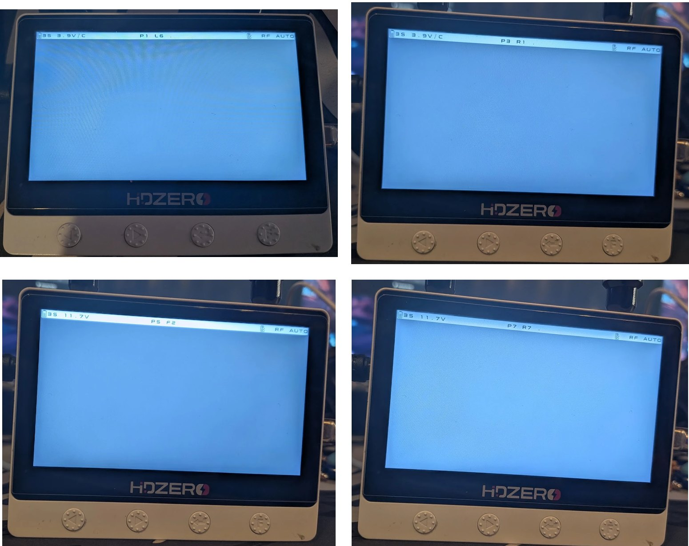
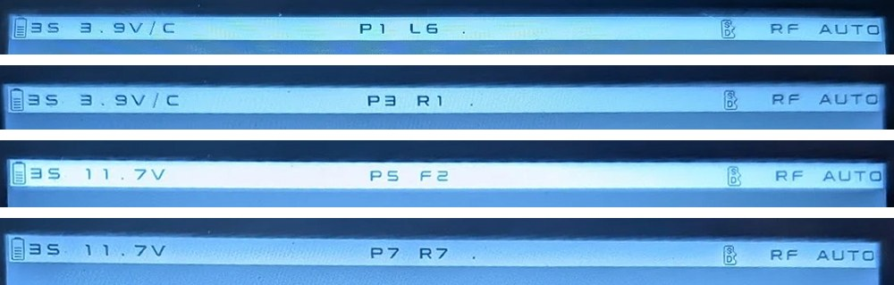

# HDZero Monitor Favorites firmware (unofficial)

A community modification of the **HDZero Monitor 1.1.1** firmware that adds a **Favorites band with the eight channels used by the Aircrasher race management** — mainly in Germany and at events such as the MultiGP European Championship — makes the built-in **scan find them**, and makes scanning **faster to trigger**. Built by reverse engineering the Monitor's DM5680 receiver firmware — no official source code was available.

> [!WARNING]
> **Tested by one person, at home, on one Monitor.** So far this firmware has only been tested by me on my own HDZero Monitor (PCB 1R3). I tried everything I could think of — switching between all favorites, changing channels on the Monitor, scanning — and it all worked well. But **neither the firmware nor the installer has been tested on anyone else's Monitor yet**. Use it **at your own risk**; at this point I cannot guarantee anything. I will update this note once other people have tested it.
>
> Unofficial and not affiliated with HDZero — see [NOTICE.md](NOTICE.md).



## Features

| Feature | What you get |
|---|---|
| **Favorites band `P`** | A seventh band after the six stock bands with **P1–P8 = L6, L7, R1, R2, F2, F4, R7, R8** — the channel set used by the Aircrasher race management (mainly in Germany, e.g. at the MultiGP European Championship), including two Lowband channels. Switch between them with the normal channel buttons, without changing bands. The selection uses the stock save path. |
| **Clear labels** | The status bar shows the slot *and* the real channel: `P1 L6 HDZ` (digital), `P1 L6 ANA` (analog), `P1 L6 ...` (searching). Stock bands look as before (`F4 HDZERO`). |
| **Scan includes all favorites** | The built-in scan list is now `R1–R8, F2, L6, L7, F4` (E1/F1 were replaced by L6/L7), so every favorite can be found. |
| **Scan stays in the Favorites band** | Started from P, a found favorite is selected as its P slot (`P2 L7 HDZ`) and the scan starts at your current slot. Started from a stock band, it behaves like stock. |
| **Faster scan trigger** | The long press that starts scanning is halved (~3 s → ~1.5 s), on both buttons and in every band. |
| **Version** | The receiver shows `FW: V1.1.2`. |



*Status bar on the Monitor: slot and real channel side by side. No transmitter was powered for these photos, so the searching indicator `.` is shown where a live link would show `HDZ` or `ANA`.*

The eight channels are a build-time setting in [`config/favorite-channels.json`](config/favorite-channels.json).

## Install

Everything is on the [Releases](../../releases) page. **Recommended: `HDZero-Monitor-Favorites-v1.1.2.zip`** — an all-in-one installer package:

| In the package | Purpose |
|---|---|
| `1-check.cmd`, `2-install.cmd`, `3-uninstall.cmd` | Double-click starters: check only / install / back to official 1.1.1 receiver |
| `tools/` | The installer [`install_favorites.py`](tools/install_favorites.py) and the modules it needs |
| `files/` | Favorites receiver image, the **official HDZero Monitor 1.1.1** file and the **WCH `CH341DLLA64.DLL`** (both unmodified; origin and SHA-256 in `THIRD-PARTY.md`), and the update file for option B |
| `README-INSTALL.md`, `THIRD-PARTY.md`, `SHA256SUMS.txt` | Instructions, provenance of the third-party files, checksums |

Also published separately: `HDZero_Monitor-v1.1.2-favorites.bin` (update file, FPGA and MStar parts **byte-identical to official 1.1.1**), `receiver-dm5680-decoded-v1.1.2-favorites.bin`, `SHA256SUMS.txt`.

### Option A — installer package with compatibility check (recommended)

Requirements: Windows, **64-bit Python 3.11+** ([python.org](https://www.python.org/downloads/) or Microsoft Store), the WCH CH341 driver (installed with the HDZero Programmer), HDZero Programmer closed, only the Monitor connected by USB.

1. Unzip, double-click **`1-check.cmd`**. Nothing is written.
2. If it passes, double-click **`2-install.cmd`**, type `INSTALL`, wait about one minute, then power-cycle the Monitor.
3. To go back: **`3-uninstall.cmd`**, type `UNINSTALL`.

**The installer checks that your Monitor and its installed firmware are compatible and only then installs**, and it only ever writes the receiver flash:

1. **Inputs:** the official 1.1.1 file and the Favorites receiver image, both SHA-256 pinned; the image is regenerated from source and compared.
2. **Device check (read-only):** exactly one CH341 (`1A86:5512`), HDZero Programmer closed, the pinned `CH341DLLA64.DLL`, flash IDs of all three chips, and the first 64 KiB of the FPGA and MStar firmware byte-identical to official 1.1.1.
3. **Installed receiver check:** status registers, two identical full reads, and the installed receiver must be official 1.1.1 or a known Favorites build. Official 1.2.0 is detected and refused unless you pass `--allow-replace-1.2.0` (its FPGA/MStar parts equal 1.1.1, so only the receiver is replaced, losing the 1.2.0 receiver changes). Anything unrecognized is refused.
4. **Write:** only with `--execute` (the install/uninstall starters) and a typed confirmation; erases only the receiver's first 64 KiB block, verifies every page plus two full readbacks, and keeps a copy of your previous receiver and a log in `install-logs/`.

From a repository checkout the same installer runs with explicit paths:

```powershell
python tools/install_favorites.py --dll "C:\path\to\HDZero Programmer\CH341DLLA64.DLL" `
  --official HDZero_Monitor.bin --receiver receiver-dm5680-decoded-v1.1.2-favorites.bin            # checks + dry run
python tools/install_favorites.py ... --execute                                                    # install
python tools/install_favorites.py ... --mode uninstall --execute                                   # back to official 1.1.1 receiver
```

If a write is interrupted, do not power off; `--mode uninstall --recover-interrupted --execute` restores the official 1.1.1 receiver.

> **Note on the installer.** The checks cover what could be verified from one development Monitor (PCB 1R3) and the official 1.1.1/1.2.0 files; other hardware revisions or firmware states are refused rather than guessed. The installer was tested against a simulated flash and, read-only, on the development Monitor — including the packaged `1-check.cmd` with the bundled files (compatibility check passed, installed build recognized, install and uninstall dry runs planned correctly); its write protocol is the one used for all verified writes. It has not yet been run on another person's Monitor. The scripts could be generalized further (e.g. other base versions, custom favorites lists, Linux) — contributions welcome.

### Option B — official HDZero Programmer

Connect the Monitor by USB, open the *Monitor* tab, choose **Load Local Firmware**, select `HDZero_Monitor-v1.1.2-favorites.bin`, update, then power-cycle the Monitor.

> ⚠️ This path was **not** tested by the authors and performs **no compatibility check**. The official programmer rewrites all three firmware parts without reading them back, exactly as for an official update, and resets the MStar part to the official 1.1.1 state. To go back, flash an official release with the same programmer.

### Option C — research tools

[`tools/monitor_usb_receiver_write.py`](tools/monitor_usb_receiver_write.py) is the original development tool, pinned to the development Monitor's backups — see [docs/toolchain.md](docs/toolchain.md).

## How it works (short)

The Monitor has three firmware parts: an **MStar** ARM processor (display/UI), a **Gowin FPGA** (HDZero video decoding) and a **DM5680 receiver** with an **8051** core that owns channel selection, RF tuning, buttons, scan and the status-bar text. All three flashes are reachable over the Monitor's own USB port through a CH341 bridge whose GPIOs switch the SPI bus between the chips.

The receiver image is stored with a fixed bit permutation (the one in HDZero's VTX build script). Decoded, it is plain 8051 code. In it we located the selection byte `(band << 3) | channel`, the band/channel step routines, the per-channel RF tables, the label writer and the scan. The Favorites band adds logical IDs `0x30–0x37` and appends extended copies of the tables, so every consumer resolves a P slot to the RF data of its real channel. All changes are small byte patches plus about 550 appended bytes, generated two independent ways (a hand-encoded generator and a byte-exact rebuild from recovered assembly) and checked by host tests.

Details: [firmware internals](docs/firmware-internals.md) · [how we got here](docs/project-history.md) · [research index](docs/README.md).

## Repository layout

| Path | Contents |
|---|---|
| [`docs/project-history.md`](docs/project-history.md) | The story: from "no source" to a flashed, verified, restorable firmware |
| [`docs/firmware-internals.md`](docs/firmware-internals.md) | Consolidated knowledge: hardware, flash layout, update format, 8051 memory map, routines, every patch |
| [`docs/README.md`](docs/README.md) | Index of all research notes (Ghidra, emulation, USB backup, flash identification, scope measurements, …) |
| [`docs/toolchain.md`](docs/toolchain.md) | What each tool does and how to reproduce the build |
| [`tools/`](tools) | **`install_favorites.py`** (installer with compatibility check) and the research tools: USB backup, receiver decode, Ghidra automation and Java scripts, candidate generator, source rebuild, packaging, flash plan, receiver-only writer, PicoScope capture |
| [`firmware/receiver/`](firmware/receiver) | New 8051 routines (MIT) and three commented recovered stock routines (see NOTICE) |
| [`tests/`](tests) | 85 host tests; many need private fixtures (official firmware / device backup) and skip without them |
| [`config/favorite-channels.json`](config/favorite-channels.json) | The eight Favorites |

## Verification status

| Verified on the device (one Monitor, 1R3) | Not verified |
|---|---|
| P1–P8 mapping, picture on all eight, labels | Flashing via the official HDZero Programmer |
| Scan from P and from stock bands, new hold time, `V1.1.2` | Other Monitor hardware revisions |
| Receiver-only write with full readback; restore to stock and re-flash | Recovery after an interrupted write (deliberately not tested) |
| Normal boot after every flash | P selection kept across a power cycle (not explicitly checked) |
| | Recording/DVR interaction, all mode transitions |

Known limitations: the Favorites list is fixed at build time; a scan from P that finds R3–R6 ends in the stock R band (these are not favorites); E1/F1 are no longer scanned in any band. An official firmware update replaces this modification.

## Roadmap

- Faster channel switching ([FUT-001](docs/tasks/fast-channel-switching.md)) — first lever found: the receiver saves nine settings with 20 ms waits before every retune.
- Port to official 1.2.0.

## License

Original work: [MIT](LICENSE). HDZero firmware and derived parts: see [NOTICE.md](NOTICE.md). Developed with substantial AI assistance (OpenAI Codex, Anthropic Claude) under the project owner's direction.
